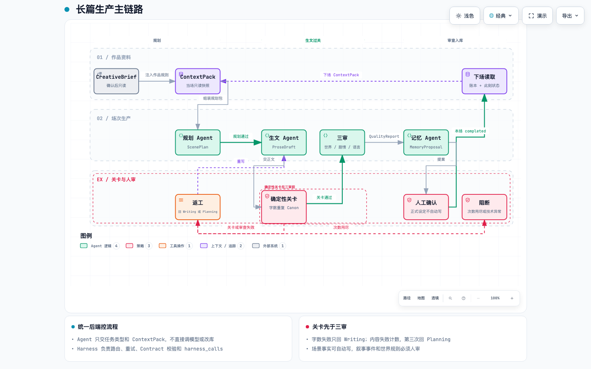

# AI 长篇小说生产系统

这是给内部内容团队使用的长篇小说生产工具。系统按“场”规划、写作、检查和保存，关注前后文衔接、返工路由和正式设定的写入权限。当前已跑通的是带固定测试资料的场次执行链路，用户提交完整作品资料的产品入口尚未接入这条链路。

仓库：<https://github.com/solve-context/ai-novel-production-system>

## 产品现状

- **生产单位是场。** 目标每场约 1250 words，硬范围 1000–1500 words，建议 1200–1350；每章两场；全书规划约 80 章、160 场。当前没有独立的全书大纲生成层，规划按场推进。
- **已验证的范围。** `v0.1.0` 完成五场真实模型链路与隔离备份恢复验收，随后完成四十场连续规模测试。160 场全书生产尚未完成，因此不能把全书目标写成已达成结果。
- **当前运行形态。** 场次生产主流程在 `integration/recovery.py`；工作台目前提供任务状态和操作入口，尚不是覆盖完整生产流程的产品界面。`systems/` 下四个目录是职责说明，不是四套独立服务。
- **资料接入边界。** 测试初始化把整份测试样例文档（含 `CreativeBrief` 和预设场次）原样存入测试库，并未拆成结构化的作品资料。运行器组装 `ContextPack` 时没有读取该文档，而是注入代码中写定的简短设定摘录。当前也没有供用户提交 `CreativeBrief` 的接口。
- **模型可以替换。** 未指定供应商时，代码默认走硅基流动。2026-09-23 的测试路由方案是写作、记忆使用 Azure Foundry 的 Claude Opus 5.5，规划、审查、裁决使用 OpenAI 的 GPT-6 Sol；实际调用仍取决于本机配置。

## 一场是怎样完成的

1. 当前测试运行器使用一段固定的作品设定摘录，后端在开始每场规划时把它与上一场结尾状态、已成立事实等组合成当场资料包；待确认的记忆提案不会混入。这还不是“用户提交完整作品资料后自动转包”的流程。
2. **规划 Agent** 写出这一场的目标、推进要求和写作安排。后端检查规划是否可用于写作，以及是否与近期场次实质重复。
3. **生文 Agent** 收到资料包和通过检查的规划卡，写出正文。官方长度是空白分词后的英文词数；当前通过范围是 **1000–1500 words**，目标约 **1250**。之后再查重、核对人物与设定、已成立事实和世界状态。
4. 正文过关后，**世界审查、剧情审查、语言审查**三位 Agent 分别看同一份资料包、规划和正文，独立提交意见；他们互相看不到对方的意见。后端汇总三份结果，检查这一场是否真的完成了规划中的剧情推进。
5. 如果出现严重问题、跨场影响或真实冲突，后端再请**裁决 Agent**处理审查分歧；普通场次不调用它。审查未通过则按原因返工。
6. 通过后，**记忆 Agent**根据正文和最终审查报告提出一条记忆变更建议。场景事实符合权限规则时可自动保存；叙事事件、世界规则和人物细节等待人工确认。没有需要记录的变化时，本场也可完成。
7. 本场完成后，下一场读取已确认的结尾状态和事实账本，继续生产。



**[下载可交互流程图](docs/archify/scene-production-workflow.html)**：在浏览器打开 HTML，可缩放、搜索节点、追踪关系和切换明暗主题。图中起点是当前运行器使用的测试设定摘录。GitHub 的 README 只展示上面的静态预览图；私有仓库中的 HTML 需下载到本机打开。图的可编辑源文件是 [Archify 流程定义](docs/archify/scene-production.workflow.json)。

### 当场资料包实际包含什么

`ContextPack` 是后端在每场规划开始时生成、保存且带内容指纹的只读快照。当前运行器先为规划环节生成一份，之后把**同一份资料包**交给生文、三位审查、按需裁决和记忆环节；各环节再分别附上规划卡、正文或审查报告，并不是每个 Agent 都收到一份重新组装的资料包。

| 内容 | 当前来源与用途 |
|---|---|
| 作品设定摘录、上一场已确认状态 | 作为带来源记录的资料条目；目前作品摘录写在运行器中，上一场状态从已通过的审查报告取得。 |
| 上一场结尾状态、世界状态 | 帮本场接续人物、地点与事件状态；世界状态由上一场状态整理。 |
| 已成立事实账本、章节摘要 | 帮规划和写作避免忘记已发生的事；从当前作品的历史记录汇总。 |
| 人物设定、场景设定 | 由后端的设定规则生成快照，供后续核对。 |
| 近期节奏、章节上下文 | 帮本场参考近期场次和本章信息。 |
| 来源版本、排除项、缺失项、冲突标记、内容指纹 | 说明资料从哪里来、哪些没纳入，以及这份资料包是否与历史版本一致。 |

资料包本身**不包含后来才生成的 `ScenePlan`、`ProseDraft` 或 `QualityReport`**；后端在调用下一环节时把这些结果与资料包并列传入。

## Agent 怎样联系、传递什么

Agent 不直接互相发消息，也不能自行改数据库。**统一后端**决定调用顺序，把上一环节的结果放进下一环节的输入；**Harness**为每次任务独立选择模型、处理技术重试、检查返回格式并记录调用。下面的箭头表示后端转交信息，而非 Agent 直接调用。

| 环节 | 收到什么 | 交出什么、交给谁 |
|---|---|---|
| 规划 Agent | 当场资料包；从第二场起还有上一场状态与剧情推进基线；返工时收到规划修改意见 | 场景规划卡 `ScenePlan` → 后端检查 → 生文 Agent |
| 生文 Agent | 当场资料包、已通过的 `ScenePlan`；返工时收到上版字数或质量问题 | 正文草稿 `ProseDraft` → 后端字数、重复和设定关卡 → 三位审查 Agent |
| 世界审查 Agent | 同一份资料包、规划卡、正文 | 世界设定与前后事实的审查意见 → 后端汇总 |
| 剧情审查 Agent | 同一份资料包、规划卡、正文 | 人物与剧情推进的审查意见，以及本场结束状态 → 后端汇总 |
| 语言审查 Agent | 同一份资料包、规划卡、正文 | 语言和阅读体验的审查意见 → 后端汇总 |
| 裁决 Agent（按需） | 资料包、规划卡、正文、三份原始意见及后端初步汇总 | 裁决后的 `QualityReport` → 后端继续核对剧情推进，决定通过或返工 |
| 记忆 Agent | 资料包、通过的正文、最终 `QualityReport` | `MemoryProposal` → 后端检查写入权限 → 自动保存或等待人工确认 |

三位审查员先各自产出一份 `ReviewerResult`，后端再合并成 `QualityReport`；剧情审查给出的结束状态是后续核对的重要依据。裁决仅在严重、跨场或冲突情形触发。内容失败通常先让生文返工；同一轮规划下第三次内容失败回到规划，后续仍失败则阻断。字数失败只回生文，单轮规划最多四次；技术异常进入待处理队列。所有历史版本和调用记录保留，恢复时只复用输入完全匹配的成功结果。

## 英文名称与系统用语

| 名称 | 在这个产品里是什么意思 |
|---|---|
| AI / Agent | 人工智能；Agent 是只完成一种明确任务的模型角色，例如规划或审查。 |
| CreativeBrief | 作品初始资料的设计名称。当前测试把含这部分内容的整份样例文档存库，运行器没有从中读取完整资料。 |
| ContextPack | 后端为某次任务整理的只读资料包，带来源与版本；Agent 只读它。 |
| ScenePlan | 一场的规划卡，说明要写什么、如何推进。 |
| ProseDraft | 生文 Agent 交出的正文草稿。 |
| ReviewerResult / QualityReport | 前者是单个审查员的意见；后者是后端汇总或裁决后的整场审查报告。 |
| MemoryProposal | 记忆 Agent 提出的事实或设定变更建议；提议本身不等于已正式写入。 |
| TaskState | 一场任务现在处于哪一步、是否等待确认或阻断，以及下一步动作。 |
| Harness | 统一的模型调用层：选模型、重试、核对结果格式、留下调用记录。 |
| Contract / Schema | 环节交接时约定的数据格式；Schema 是格式的机器可读规则。 |
| Canon | 已确认且后续写作必须遵守的人物、世界和事实设定。 |
| Archify / HTML | Archify 是生成本页流程图的工具；HTML 是可在浏览器打开的交互文件格式。 |
| API / REST | 工作台向后端查询任务或提交操作的接口；REST 是这里使用的接口组织方式。 |
| Python / SQLite | 后端使用的编程语言和本地数据库。 |
| Mock | 用预设的模拟结果验证流程分支，不消耗真实模型调用。 |
| Azure Foundry / Claude Opus 5.5 / OpenAI / GPT-6 Sol / 硅基流动 / DeepSeek | 可配置的模型平台或模型名称；它们是执行 Agent 任务的供应来源，不改变 Agent 分工。 |
| GitHub | 本项目保存代码和文档的组织仓库。 |
| Planning / Writing / completed | 图中的“规划 / 写作 / 本场已完成”状态或环节。 |
| `.env` / `RUN_REAL_MODEL` / `REAL_TEST_AUTO_CONFIRM` / `not_run` | 分别是本机配置文件、真实模型测试开关、测试代确认开关，以及未启动真实测试时的返回状态。 |

## 本地查看与运行

克隆仓库后，本机需要这些东西。密钥和已经跑完的小说库都不在仓库里。

- **Python 3.11 或更高。** `./scripts/dev_up.sh` 会检查版本。不满足时直接退出。
- **两个 Python 包。** `requirements.txt` 里是 `anthropic` 和 `azure-identity`。启动脚本会在仓库根目录创建 `.venv`，并用它安装这两个包。其余后端代码使用 Python 标准库。
- **SQLite。** 使用 Python 自带的 SQLite。库文件写在 `data/`，不进入仓库。不需要单独安装数据库，也不需要 Node。
- **本机网络。** 只打开工作台、或跑不调用模型的验收，不需要模型账号。要写出真实正文，本机必须能访问所选模型平台。

在仓库根目录执行：

```sh
./scripts/dev_up.sh
```

打开 `http://127.0.0.1:8124/` 查看工作台，或打开 `http://127.0.0.1:8124/admin.html` 查看管理页。`./scripts/dev_check.sh` 检查服务，`./scripts/dev_down.sh` 停止服务。页面当前主要支持查看任务状态，以及暂停、恢复、重新规划、重新生文和取消等操作。工作台默认使用 `data/local.db`，可用 `NOVEL_DB` 改路径，用 `DEV_HOST`、`DEV_PORT` 改地址，默认端口是 `8124`。

### 真实正文需要的模型账号

密钥只放在本机 `.env` 或当前终端的环境变量里。`.env` 不进入仓库。仓库里也没有示例密钥文件，需要自己新建 `.env`，只写变量名和自己的值。

没有指定供应商时，代码默认走硅基流动，这时需要 `SILICONFLOW_API_KEY`。已经跑完的英文长篇没有用这个默认，而是显式分成两路：

| 环节 | 环境变量 | 值 |
|---|---|---|
| 生文、记忆 | `WRITING_PROVIDER`、`MEMORY_PROVIDER` | `azure_foundry` |
| 规划、三位审查、裁决 | `PLANNING_PROVIDER`、`REVIEW_PROVIDER`、`ARBITER_PROVIDER` | `openai` |

Azure Foundry 这一路还需要：

- `AZURE_FOUNDRY_CLAUDE_ENDPOINT`：自己的 Foundry 地址。
- `AZURE_FOUNDRY_CLAUDE_API_KEY`，或者改用登录身份：`AZURE_FOUNDRY_AUTH=entra`。
- 部署名可以不写。不写时用 `claude-opus-5`。要换部署，设置 `AZURE_FOUNDRY_CLAUDE_DEPLOYMENT`。

OpenAI 这一路还需要：

- `OPENAI_API_KEY`。
- 地址可以不写。不写时用 `https://api.openai.com/v1/chat/completions`。要换地址，设置 `OPENAI_API_URL`。
- 模型名可以不写。不写时用 `gpt-6-sol`。

另一条可选路线是 DeepSeek：把对应环节的供应商设为 `deepseek`，并提供 `DEEPSEEK_API_KEY`。地址可用 `DEEPSEEK_API_URL` 覆盖。

缺少当前路由所需的密钥时，适配器直接失败，不会编造正文。真实场次运行器是 `integration/run_real_test.py`。未设置 `RUN_REAL_MODEL=1`，或缺少当前路由的密钥时，它返回 `not_run`。场数用 `REAL_TEST_SCENE_COUNT`，数据库路径用 `REAL_TEST_DB`，应指向一个新的库文件，不要覆盖已完成的库。`EXECUTION_MODE` 不写时是 `sequential`。`REAL_TEST_AUTO_CONFIRM=1` 只表示测试操作员代确认提案，不代表 Agent 可以自行批准正式设定。

## 仓库地图

| 目录 | 用途 |
|---|---|
| `backend/` | 场次规则、Agent 调用、资料包、任务状态、记忆确认和测试 |
| `contracts/` | 七类业务交接内容的数据约定 |
| `integration/` | 真实模型运行器、场次恢复和备份操作 |
| `acceptance/` | 不调用真实模型的固定场景验收 |
| `frontend/` | 创作工作台与管理页原型 |
| `db/`、`data/` | 数据库结构；本地运行数据与备份保存在 `data/`，不入库 |
| `docs/`、`systems/` | 方案、验收、流程图和逻辑职责说明 |

进一步阅读：[本项目架构说明](docs/系统架构README-本项目.md) · [业务交接格式](contracts/README.md) · [第一版本地验收说明](docs/第一版本地验收发布说明-v0.1.0.md)。
