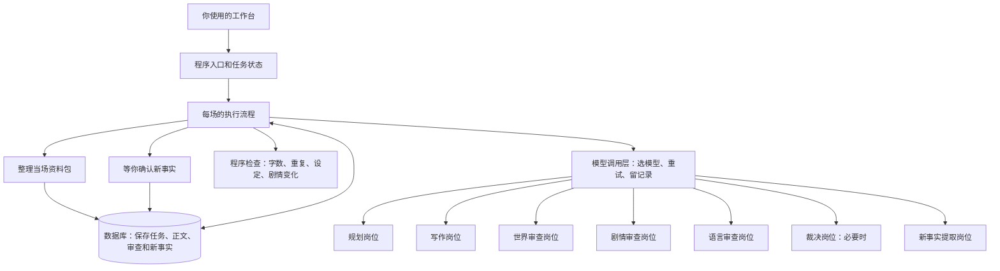

# AI 长篇小说生产系统 PRD（个人开发版）

> 文档版本：v1.1｜核对日期：2026-09-24｜适用范围：当前仓库的场次生产链路。正文先讲系统如何工作，再解释代码字段；英文参数后直接标注中文含义。文末保留程序当前使用的提示词原文，方便你核对和修改。

## 1. 产品定位与边界

**使用者**：你自己。你既可以启动写作、查看结果，也可以确认新设定、处理失败任务。文中的“人工确认”是系统停下来等你决定，并不意味着需要另一个团队。

**这个产品做什么**：一次写一场小说。每场先定计划，再写正文，检查通过后把结果带到下一场。写错了就按原因重写；新设定先让你确认。你能查到每一版计划、正文和修改原因。

**现在做到哪了**：固定测试资料驱动的写作流程已经跑通，做过五场真实模型验收和四十场连续测试。目标是约 80 章、160 场、20 万字，全书尚未完成验证。现在的页面主要能看任务状态、执行操作。作品资料还不能由你在页面提交并自动进入写作流程；程序目前使用写在代码里的简短设定摘录。参见 [项目 README](../README.md)。

**两个用语**：下文把 Agent 称为“模型岗位”，意思是给模型分配一种固定工作；把 Harness 称为“模型调用层”，它负责选模型、发请求、重试和记录。模型岗位不能自己改正式设定，程序负责决定下一步。

## 2. 系统结构：谁负责哪一步



**代码在什么位置**：页面在 `frontend/`；任务接口在 `backend/api.py`；每场执行顺序在 `integration/recovery.py`；资料包在 `backend/context_pack.py` 生成；模型请求由 `backend/harness.py` 和供应商适配器处理；检查规则在 `backend/`；数据表在 `db/`。[`systems/`](../systems/) 是职责说明目录，不是四个独立运行的服务。

**执行方式**：一场只生成一份当场资料包，后面的步骤反复使用它。世界、剧情、语言三个审查岗位分别看同一份计划和正文，不读取彼此的意见。程序目前依次调用这三个岗位。只有严重问题、影响后续场次的问题或相互冲突的审查意见，才调用裁决岗位。顺序写作时，上一场完成后才开始下一场。

## 3. 核心链路：节点职责、输入与输出

| 步骤 | 谁来做 | 需要什么 | 做什么 | 产出什么、交给谁 |
|---|---|---|---|---|
| 0. 开始本场 | 程序 | 作品编号、章节编号、场次编号、上一场的通过结果 | 确认上一场已经完成，读取其最终状态；第一场没有前场状态 | 本场起点 → 组资料包 |
| 1. 组当场资料包 | 程序 | 作品设定摘录、上一场结果、已经发生的事、章节信息、人物及地点设定 | 只选本作品可用的信息；待确认的新设定不放进去；给资料包保存版本和内容指纹 | 当场资料包 → 规划，并供后续步骤复用 |
| 2. 规划 | 规划模型岗位 | 场次序号、当场资料包；第二场起再给上一场状态；重做时附上错误原因 | 定本场目标、开头和结尾状态、主要行动、不能写的事、关键剧情变化 | 场景规划卡 → 程序检查 |
| 3. 检查规划 | 程序 | 场景规划卡、上一场状态、近期已完成场次 | 检查信息是否齐全、目标字数是否正确、剧情变化的起点是否有依据、是否重复写旧剧情 | 通过 → 写正文；失败 → 重做规划或停下处理 |
| 4. 写正文 | 写作模型岗位 | 同一份当场资料包、通过的规划卡；重写时再给旧稿和具体错误 | 写出完整一场，遵守人物、场景和本场计划 | 正文草稿 → 程序检查 |
| 5. 检查正文 | 程序 | 正文、规划卡、资料包、已写过的正文 | 实算字数，检查重复、人物关系、地点设定、已经发生的事和当前世界状态 | 通过 → 三项审查；失败 → 重写或停下处理 |
| 6a. 世界审查 | 世界审查模型岗位 | 同一份资料包、规划卡、正文 | 查设定、地点、时间、角色能知道什么、前后是否矛盾 | 一份审查意见 → 程序汇总 |
| 6b. 剧情审查 | 剧情审查模型岗位 | 同一份资料包、规划卡、正文 | 查人物行为和剧情变化是否成立，记下本场结束时的状态 | 一份审查意见 → 程序汇总 |
| 6c. 语言审查 | 语言审查模型岗位 | 同一份资料包、规划卡、正文 | 查句子、节奏、阅读是否顺畅 | 一份审查意见 → 程序汇总 |
| 7. 汇总与裁决 | 程序；必要时调用裁决模型岗位 | 三份意见；裁决时再看资料包、规划和正文 | 分清必须修的问题与可选建议；遇到严重或跨场问题时作最终判断 | 整场审查报告 → 检查剧情变化 |
| 8. 检查剧情变化 | 程序 | 规划中要求发生的变化、正文、审查给出的原文证据 | 核实正文里确实发生了计划中的变化，不能只在审查意见里声称完成 | 通过 → 记录新事实；失败 → 重写或停下处理 |
| 9. 记录新事实 | 记忆模型岗位、程序 | 同一份资料包、通过的正文、最终审查报告 | 找出值得以后继续记住的一条新事实，并给出正文证据；也可以说明本场没有新事实 | 记忆提案；普通场景事实可自动保存，其他提案等你确认 |
| 10. 确认与结束 | 你、程序 | 待确认的新事实 | 你确认或拒绝；程序保存决定和理由 | 本场完成；下一场只读取已经确认的结果 |

**一句话看节点关系**：当场资料包 → 规划卡 → 正文 → 三份审查意见 → 整场审查报告 → 新事实提案 → 正式记忆。程序负责传递和保存，模型岗位之间不直接通信。任务状态会一直记录这场进行到哪里。作品初始资料格式已经设计，但尚未完整接入这条链路。

**写错了怎么办**：规划不合格就重做规划。正文有内容问题先重写；同一张规划卡下第三次内容失败，就重新规划。换过一次规划后再出现内容失败，任务会停下让你处理。字数不合格只重写正文，同一张规划卡最多尝试四次。模型请求出错时，程序记录错误，再从出错处重试。相同正文再次提交会立即停下。你可以暂停、恢复、取消、跳过或主动要求重做。

## 4. 参数字典

### 4.1 共同约定与标识

| 参数 | 解释 |
|---|---|
| `contract_type`（业务对象类型） / `contract_version`（字段格式版本） / `payload`（具体内容） | 业务对象类型、格式版本和实际内容。模型输出采用这三个键的 JSON 外壳；当前版本为 `v1`。 |
| `book_id`（作品编号） / `chapter_id`（章节编号） / `scene_id`（场次编号） | 作品、章节、场次的稳定标识，用于限制资料范围与串联记录。 |
| `brief_id`（作品资料编号） / `plan_id`（规划卡编号） / `context_pack_id`（资料包编号） / `draft_id`（正文编号） / `report_id`（审查报告编号） / `proposal_id`（记忆提案编号） / `task_id`（任务编号） | 各业务对象的唯一标识。 |
| `*_version`（对应资料的版本号） | 对应对象的版本号。`plan_version`（规划卡版本） 是规划卡版本；`plan_attempt`（重新规划的周期数） 是内容返工导致的规划周期计数，两者含义不同。 |
| `source_draft_id`（提案所依据的正文编号） / `source_report_id`（提案所依据的审查报告编号） / `harness_call_id`（模型调用记录编号） | 提案引用的正文和报告、正文引用的实际模型调用，供追溯。 |
| `content_hash`（资料包内容指纹） / `draft_hash`（正文内容指纹） / `scene_plan_snapshot_hash`（规划卡快照指纹） | 内容指纹，用于检测快照或正文是否与记录一致；最后一项在静态 ContextPack 字段规则 中定义，当前运行器组包时并未填充。 |
| `created_at`（创建时间） / `updated_at`（更新时间） / `assembled_at`（组包时间） | 创建、更新、资料包组装时间。 |

### 4.2 作品初始资料（CreativeBrief，尚未完整接入）

| 参数 | 解释 |
|---|---|
| `brief_id`（作品资料编号）, `book_id`（作品编号）, `brief_version`（作品资料版本） | 资料自身、所属作品和版本。 |
| `status`（状态） | `draft`（草稿）、`confirmed`（已确认）、`superseded`（被新版替代）。 |
| `title`（书名）, `genre`（作品类型）, `theme`（作品主题）, `target_length`（全书目标长度） | 定义作品的基本信息和计划篇幅。 |
| `main_characters`（主要人物）, `character_relationships`（人物关系） | 记录主要人物及关系；目前只规定为列表，单个人物的细项尚未固定。 |
| `world_background`（世界背景）, `core_rules`（核心世界规则） | 记录世界背景和必须遵守的规则。 |
| `main_conflict`（全书主要冲突）, `style_requirements`（文风要求）, `ending_direction`（结局方向）, `special_requirements`（特别要求） | 告诉系统整部作品的冲突、写法、结局方向和额外限制。 |

### 4.3 当场资料包（ContextPack）

| 参数 | 解释 |
|---|---|
| `context_pack_id`（资料包编号）, `book_id`（作品编号）, `scene_id`（场次编号） | 用来确认这份资料包属于哪部作品、哪一场。`context_pack_version`（资料包版本）、`chapter_id`（章节编号）、`target_agent`（目标模型岗位）、`target_node`（目标步骤）、`plan_version`（规划卡版本）保存在数据库行，未全部放入传给模型的资料内容；组包函数虽然接收 `brief_version`（作品资料版本），目前也没有放入资料内容。 |
| `fixture_id`（测试场次标识） | 当前运行器形成的 `book_id:scene_id` 测试标识。 |
| `approved_facts`（准许使用的资料条目） | 每条资料带 `source_id`（来源编号）、`source_version`（来源版本）、`selection_reason`（选入原因）、`content`（内容）、`score`（排序分数）、`target_key`（对应事实的编号）。当前主要装入代码内置设定摘录和上一场确认状态。 |
| `previous_scene_state`（上一场结束状态） | 前场确认后的在场人物、地点、时间、事件、关系变化和未解决悬念。第一场为空对象。 |
| `established_facts`（已成立事实账本） | 包含 `canon_version`（正式设定版本）、`rule`（规则名）、`facts`（已成立事实清单）。 |
| `chapter_summary`（章节历史摘要） | 账本裁剪后保留的历史章节概述。 |
| `character_canon`（已确认的人物设定） / `setting_canon`（已确认的场景设定） | 当前测试作品的人物设定快照、场景设定快照。两者目前是代码中的固定规则。 |
| `world_state`（当前世界状态） | 从前场状态整理的当前位置、时间、在场者 `present`（在场人物）、离场者 `offstage`（不在场人物）、时钟 `clocks`（时间记录）、度量 `measures`（距离或数量记录）、日期关系 `day_relation`（与上一场的日期关系）。 |
| `pacing_state`（近期节奏信息） | 包含 `same_location_run`（连续停在同一地点的场数）、`recent_locations`（近期地点）、`recent_goals`（近期目标）、`stall_markers`（等待或复查的重复信号）、`prior_locations`（之前去过的其他地点）。 |
| `chapter_state`（当前章节信息） | 包含 `chapter_number`（章号）、`scene_in_chapter`（本章第几场）、`scenes_in_chapter`（本章总场数）、`is_chapter_open`（是否章首）、`is_chapter_close`（是否章末）、`destination`（本章计划去向）、`previous_destination`（上一章计划去向）、`previous_end_location`（上一章结尾地点）。 |
| `story_state_version`（剧情状态版本）, `canon_version`（正式设定版本） | 剧情状态版本、设定版本。 |
| `excluded_sources`（排除的来源）, `missing_sources`（缺失的来源）, `conflicts`（资料冲突记录） | 被排除来源、缺失来源、相同目标出现不同内容时保留的冲突记录。 |
| `content_hash`（资料包内容指纹） | 把资料内容计算成一个固定标识；同一场、同一版本重新组包却得出不同内容时，程序会报冲突。 |

**组包时传入的字段**：`sources`（候选资料）、`keywords`（检索关键词）、`excluded_sources`（指定排除的来源）、`missing_sources`（缺失来源）、`previous_scene_state`（上一场状态）、`established_facts`（已发生事实）、`pacing_recent`（近期场次记录）、`chapter_context`（本章信息）。只选本作品的资料；状态为 `pending`（待确认）的提案不会进入资料包。同一 `target_key`（事实对象编号）若有互相矛盾的内容，两条都会保留并标记冲突。

### 4.4 场景规划卡（ScenePlan）

| 参数 | 解释 |
|---|---|
| `plan_id`（规划卡编号）, `book_id`（作品编号）, `chapter_id`（章节编号）, `scene_id`（场次编号）, `plan_version`（规划卡版本）, `brief_version`（作品资料版本）, `story_state_version`（剧情状态版本） | 规划卡自身、归属与所依赖版本。模型主要生成内容字段，后端保存时补齐标识和版本。 |
| `scene_goal`（本场目标） | 本场要完成的具体目标。 |
| `entrance_state`（开场状态） / `exit_state`（预期结尾状态） | 本场开头状态和预期结束状态；两者为对象。 |
| `characters`（人物）, `location`（地点）, `time_context`（时间背景） | 本场人物、主要地点、时间语境；必须在规划内容顶层独立给出。 |
| `conflict`（本场冲突）, `action_beats`（行动节拍） | 本场阻力或冲突、按顺序发生的关键行动节拍。 |
| `must_happen`（必须发生）, `must_not_happen`（不得发生） | 正文必须发生的事、不得发生的事。 |
| `knowledge_boundary`（角色知情边界） | 角色和叙述者能知道什么，防止越权揭示信息。 |
| `target_word_count`（目标字数） | 正文目标值，当前规划必须是 `1250`；这是目标，不是硬性通过区间。 |
| `acceptance_criteria`（完成标准） | 判断本场是否完成目标的标准；字段规则 定义为对象数组，模型提示词只要求非空，具体子结构尚未完全收紧。 |
| `validation_result`（规划自检结果）, `ready_for_writing`（是否可进入写作） | 规划 模型岗位 自检结果、能否进入写作；后端再次验证。 |
| `progression_requirements`（剧情推进要求） | 剧情推进要求数组，每项必须有下表五个键；目前提示词建议 1～3 项。 |
| `chapter_destination`（本章计划终点） | 章首规划可写的本章终点：具体去向或要打开、关闭的悬念；字段规则 中为可选项。 |

| `progression_requirements`（剧情推进要求） 子参数 | 解释 |
|---|---|
| `progress_type`（推进类型） | 推进类别：`new_clue`（新线索）、`character_state_change`（人物状态变化） 人物状态改变、`relationship_change`（人物关系变化） 关系改变、`conflict_change`（冲突变化） 冲突改变、`decision_or_consequence`（决定或后果）、`thread_opened`（开启悬念）、`thread_advanced`（推进悬念）、`thread_closed`（关闭悬念）、`goal_milestone`（阶段目标达成）。 |
| `target_key`（具体事实对象编号） | 被改变的线索、人物、关系、冲突、悬念或目标的稳定标识。 |
| `before_state`（变化前状态） | 改变前状态。第二场起须从上一场推进基线的对应字段原样复制；真正新增的线索或悬念可写“未知”。 |
| `expected_after_state`（预期变化后状态） | 本场预计达到的具体新状态。 |
| `acceptance_criterion`（本项验收标准） | 后续在正文中确认这一变化的判定标准。 |

### 4.5 正文草稿（ProseDraft）

| 参数 | 解释 |
|---|---|
| `draft_id`（正文编号）, `book_id`（作品编号）, `chapter_id`（章节编号）, `scene_id`（场次编号）, `draft_version`（正文版本）, `attempt`（生成序号） | 草稿自身、归属、版本和生成序号；后端持久化时补齐。 |
| `plan_version`（规划卡版本）, `context_pack_version`（资料包版本） | 本稿绑定的规划卡和资料包版本。 |
| `text`（正文全文） | 场景正文全文。 |
| `word_count`（入库后的官方词数；列名是历史名） | 入库后以后端 `actual_word_count`（空白分词）为准；`don't` / `it's` 算 1 词。模型原始自报值另存 `model_reported_word_count`。 |
| `actual_character_count`（程序实算值；列名是历史名） | 与入库 `word_count` 同口径，值是 word count，不是非空白汉字。 |
| `target_word_count`（目标词数） | 规划目标值必须正好 `1250` words。 |
| `length_validation_status`（长度检查结果）, `length_validation_reason`（长度失败原因） | 长度关卡结果 `passed/failed`；失败原因为 `empty_text`（正文为空）、`under_length`（正文过短）、`over_length`（正文过长）。 |
| `complete`（是否完成）, `writer_self_check`（写作模型自检） | 模型声明是否写完、模型自检信息；不能代替后端检查。 |
| `status`（状态）, `draft_hash`（正文内容指纹）, `harness_call_id`（模型调用记录编号） | 草稿状态、正文指纹、产生本稿的调用 ID。 |
| `content_attempt_in_plan`（本轮规划下的内容失败次数或草稿序号）, `content_attempt_total`（本场内容失败总数或草稿序号） | 草稿生成序号；与 `TaskState` 中只统计内容失败的同名计数口径不同。 |

### 4.6 单项审查意见（ReviewerResult）与整场审查报告（QualityReport）

`ReviewerResult`（单项审查意见）是三个审查模型返回的数据。当前静态字段清单尚未单独列出它，但程序会检查返回内容。三个岗位都必须交以下字段：

| 参数 | 解释 |
|---|---|
| `reviewer_role`（审查岗位） | `world_consistency`（世界审查）、`character_plot`（剧情审查）、`language_experience`（语言审查）；必须与实际岗位一致。 |
| `result`（审查结论） | `passed` 或 `failed`。 |
| `findings`（必须修改的问题）, `suggestions`（可选优化建议） | 只有前者会导致返工，后者只是建议。 |
| `issue_count`（必须修改的问题数） | 必须等于 `findings`（必须修改的问题） 的条数。 |
| `severity`（问题严重程度） | `ordinary`（普通）或 `serious`（严重）。 |
| `impact_scope`（问题影响范围） | `local`（本场）、`cross_scene`（跨场）、`cross_chapter`（跨章）、`book`（全书）。 |
| `true_conflict_candidate`（是否存在真实冲突） | 是否发现需要裁决的真实冲突。 |
| `scene_state`（本场结束状态） | 审查员提取的本场结束状态，含 `characters`（人物）、`location`（地点）、`time_context`（时间背景）、`events`（已发生事件）、`relationship_changes`（人物关系变化）、`unresolved_threads`（未解决悬念）。剧情审查版本是后端汇总的主要来源。 |
| `progression_assessment`（剧情推进评估） | 剧情审查逐项核对计划：`status`（结果）只能是 `achieved`（已达成）、`not_achieved`（未达成）、`unclear`（无法判断）；`achieved_items`（达成项）、`missing_items`（未达成项）分别记录结果。达成项还要写原计划的 `progress_type`（变化类型）、`target_key`（变化对象）、`before_state`（变化前状态），以及实际 `after_state`（变化后状态）、`evidence_text`（正文原文证据）、`evidence_location`（证据位置）。 |

| `QualityReport`（整场审查报告） 参数 | 解释 |
|---|---|
| `report_id`（审查报告编号）, `book_id`（作品编号）, `chapter_id`（章节编号）, `scene_id`（场次编号）, `draft_id`（正文编号）, `draft_hash`（正文内容指纹）, `review_attempt`（审查轮次） | 报告身份、归属、绑定正文及审查轮次。 |
| `review_completion_status`（审查完成情况） | `pending`（等待中）、`completed`（已完成）、`partial`（只完成一部分）、`failed`（审查失败）；裁决输出必须为“已完成”。 |
| `reviewer_results`（三份审查意见） | 三份原始审查结果；裁决后仍保留可追溯意见。 |
| `deduped_issue_count`（标称去重后的问题数）, `ordinary_issue_count`（普通问题数）, `serious_issue_count`（严重问题数） | 分别记录问题总量、普通问题和严重问题。目前第一个字段只是计数，尚未真正把同一问题的重复表述合并。 |
| `has_true_conflict`（是否有真实冲突）, `needs_arbiter`（是否需要裁决） | 是否存在真实冲突候选、是否需要裁决。 |
| `routing_recommendation`（建议下一步） | 初步结果可为 `arbiter`（交给裁决）、`complete`（完成）、`rewrite`（重写）；裁决之后只能是完成或重写。 |
| `accepted_scene_state`（被确认的本场结尾状态） | 本场被接纳的结束状态，是下一场起点的来源。 |
| `status`（整场结论） | `passed`（通过）、`failed`（未通过）、`needs_arbiter`（需要裁决）；通过后才记录新事实。 |
| `progression_status`（剧情变化检查结果） | 程序核实计划中的变化是否真的写进正文：`passed`（通过）或 `failed`（未通过）。 |
| `planned_progression_count`（计划推进项数）, `achieved_progression_count`（已达成推进项数） | 规划推进项数、验证达成项数。 |
| `verified_progression_items`（已核实的推进项）, `missing_progression_items`（未完成的推进项）, `progression_failure_reason`（剧情推进失败原因） | 已核实的推进项、未完成项和失败原因。裁决 模型岗位 不自行填写，由后端核验后写入。 |

### 4.7 新事实提案（MemoryProposal）与任务状态（TaskState）

| `MemoryProposal`（新事实提案） 参数 | 解释 |
|---|---|
| `proposal_id`（记忆提案编号）, `book_id`（作品编号）, `chapter_id`（章节编号）, `scene_id`（场次编号）, `source_draft_id`（提案所依据的正文编号）, `source_report_id`（提案所依据的审查报告编号）, `proposal_version`（记忆提案版本） | 提案身份、归属、证据来源与版本。 |
| `memory_type`（记忆类型） | 当前运行时允许 `scene_fact`（场景事实）、`narrative_event`（叙事事件）、`world_rule`（世界规则）、`character_detail`（人物细节）。 |
| `target_scope`（写入范围） | `scene_memory`（场景记忆）、`book_memory`（作品记忆）、`character_memory`（人物记忆）。 |
| `target_key`（具体事实对象编号） | 被修改事实的具体、稳定标识，必须指向当前作品中的人物、地点、事件或场景事实。 |
| `action`（修改动作） | `create`（新建）、`update`（更新）、`delete`（删除）。 |
| `before_value`（修改前内容）, `after_value`（修改后内容） | 修改前、修改后的值。 |
| `evidence`（证据）, `evidence_location`（证据位置）, `change_reason`（修改原因） | 正文证据、证据位置、修改理由。 |
| `conflict_status`（是否存在冲突） | `none/conflict/resolved`。 |
| `write_policy`（写入方式） | `auto_save`（自动保存）、`human_confirmation`（等你确认）、`never_auto_write`（禁止自动写入）。目前场景事实可自动保存；叙事事件、世界规则、人物细节要等你确认。 |
| `status`（状态） | `pending/approved/rejected/written/conflict`；没有持久变化时运行时允许只返回 `{ "status": "skipped", "reason": "原因" }`，不生成提案记录。 |

| `TaskState`（任务状态） 参数 | 解释 |
|---|---|
| `task_id`（任务编号）, `task_scope`（任务范围）, `book_id`（作品编号）, `chapter_id`（章节编号）, `scene_id`（场次编号） | 任务标识、粒度 `book/chapter/scene` 及归属。当前主链按场执行。 |
| `current_node`（当前步骤） | `planning`（规划）、`writing`（写作）、`reviewing`（审查）、`arbiter`（裁决）、`memory_processing`（记忆处理）、`human_confirmation`（等你确认）、`exception_handling`（异常处理）。任务结束后仍保留最后一步。 |
| `status`（任务状态） | `queued`（排队）、`running`（运行中）、`reworking_writing`（重写）、`reworking_planning`（重做规划）、`waiting_confirmation`（等你确认）、`paused`（暂停）、`exception_pending`（待处理异常）、`blocked`（阻断）、`completed`（完成）、`skipped`（跳过）、`cancelled`（取消）。 |
| `next_action`（下一步动作） | 下一步由后端执行或允许操作员触发的动作。 |
| `plan_attempt`（重新规划的周期数） | 内容失败导致回规划的周期次数，从 1 开始；不等于规划卡版本。 |
| `content_attempt_in_plan`（本轮规划下的内容失败次数或草稿序号）, `content_attempt_total`（本场内容失败总数或草稿序号） | 当前规划周期与整场累计的内容失败次数；字数失败、技术失败不计入。 |
| `technical_retry_count`（技术错误重试次数） | 技术异常重试次数。 |
| `active_contract_refs`（当前使用的资料版本引用） | 当前有效的规划、草稿、报告或返工指令引用。 |
| `pause_reason`（暂停原因）, `block_reason`（阻断原因）, `exception_id`（异常记录编号）, `skip_record`（跳过记录）, `last_error`（最近错误） | 暂停原因、阻断原因、异常记录、跳过造成的连续性缺口、最近错误。 |
| `idempotency_key`（防重复提交的请求标识）, `run_lock`（任务运行锁）, `state_version`（任务状态版本）, `state_history`（状态变化记录） | 防重复创建的请求键、运行锁、状态并发版本、状态变化历史。 |

### 4.8 运行阈值和 Harness 参数

| 参数 | 当前值与含义 |
|---|---|
| 正文目标 / 软建议 / 硬通过范围 | 规划目标 `1250` words；写作提示建议 `1200～1350` words；硬范围 **1000–1500 words**。验收与提示词同一套数字。 |
| `MAX_LENGTH_FAILURES_IN_PLAN`（同一规划允许的最长返工次数） | `4`；同一规划版本第四次长度失败后阻断。 |
| `LOOKBACK_SCENES`（查重时回看的场数） | `3`；规划与正文重复检查比较近期三场。 |
| `PLAN_GOAL_THRESHOLD`（规划目标相似度阈值） / `PLAN_ACTION_THRESHOLD`（规划行动相似度阈值） / `PLAN_OVERALL_THRESHOLD`（整张规划卡相似度阈值） | `0.80 / 0.65 / 0.75`；规划目标、行动、整体三字片段相似度阈值。 |
| `OPENING_THRESHOLD`（正文开头相似度阈值） / `BODY_THRESHOLD`（正文主体相似度阈值） | `0.72 / 0.55`；正文开头和正文主体相似度阈值；开头截取 `120` 字符。 |
| `provider`（模型平台） / `model`（模型名称） | 每个模型岗位用哪个平台、哪个模型，由模型调用层的配置决定；未配置平台时默认硅基流动。 |
| `timeout_seconds`（单次调用超时秒数） / `technical_retries`（技术错误自动重试次数） / `max_output_tokens`（最多生成的文本量） / `budget_limit`（可选调用预算上限） / `prompt_version`（提示词版本） | 单次超时、技术重试次数、最大输出 token、可选预算上限、提示词版本；记录在模型配置或调用记录中。默认 `technical_retries=1`；实际超时和输出上限由所选路由决定。 |
| `MODEL_PROVIDER`（全局模型平台配置） / `STRUCTURED_PROVIDER`（结构化任务的平台配置） / 各任务 `*_PROVIDER` | 全局、结构化任务分组、单任务供应商配置；单任务配置优先。任务名包括 `planning`、`writing`、`review_world`、`review_plot`、`review_style`、`arbiter`、`memory_extraction`。 |

## 5. 模型岗位使用的提示词

程序给模型的消息按三个部分拼起来：**统一的输出格式要求 → 本场资料、规划和正文 → 这个岗位要做的具体工作**。返工时再加入旧稿和失败原因。因此提示词不是七个独立文件，实际内容由代码生成。想改提示词，可从 [`build_chat_messages`](../backend/siliconflow.py) 开始看；完整固定文本在文末附录 A。

| 模型岗位 | 告诉它必须怎样回答 | 告诉它具体要做什么 | 提示词版本 |
|---|---|---|---|
| 规划 | 只交一张场景规划卡；目标字数设为 1250；人物、地点、时间和起止状态都写全 | 定下本场必须发生的具体变化，并以已知事实作为起点 | `planning_progression_v4` |
| 写正文 | 只交一篇完整正文；建议 1200～1350 words；每段推动行动或结果 | 遵守规划中的禁写事项和角色知情范围；重写时按旧稿长度或审查意见修改 | `prose_quality_v9` |
| 世界审查 | 问题分为“必须修改”和“可选建议” | 只查世界规则、人物设定、地点、时间和前后连续性 | `reviewer_contract_v8` |
| 剧情审查 | 每个“已完成”的剧情变化都要找到正文连续原文作证据 | 查人物行为和剧情变化，写出本场结束状态 | `reviewer_contract_v8` |
| 语言审查 | 同样分开“必须修改”和“可选建议” | 只查语言、节奏、可读性和明显表达错误 | `reviewer_contract_v8` |
| 裁决 | 给出“通过”或“重写”，不能把剧情变化自称为已核实 | 对照规划、正文和三份意见作最终判断 | `arbiter_contract_v2` |
| 记忆 | 只交一条新事实提案；没有新事实就写明原因 | 从通过的正文中提取有证据的虚构事实变化 | `v1` |

**附录 A 是程序当前固定提示词的原文**，保留英文以便直接对照代码。返工提示会随失败原因、旧稿和审查意见变化，不能只看附录判断一次实际调用收到了什么。

## 6. 当前实现与产品化待办

1. **让你能录入作品资料**：支持填写、确认和更新作品资料，再让写作流程真正读取这些资料。现在使用的测试设定、人物和场景规则仍写在代码中。
2. **统一字段定义**：字段规则文件与实际运行结果有差异。例如，当场资料包的必填项不一致；记忆类型的可选值也不一致；单项审查意见缺少完整的静态字段定义。应先统一规则，再迁移旧数据。详见 [字段规则文件](../contracts/contracts.schema.json)。
3. **统一字数标准**：给写作模型的提示要求至少 1000 字符，程序实际从 800 字符起放行。你需要决定最终产品标准，并同步修改提示词和程序检查。
4. **准确显示审查问题数**：当前“去重后问题数”只是在数问题，还没有把三份意见中重复的问题合并。界面展示前应实现合并或改名。
5. **完善个人工作台**：在一个页面里查看资料来源、规划、正文、三份审查、返工原因、新事实确认和技术错误。

## 7. 验收口径

- 每场只能从已确认的前场结束状态继续；待确认提案不得混入下一场生文资料。
- 任一版本都能定位其资料包、规划、草稿、审查报告、模型调用和记忆提案；重复恢复不得覆盖不同历史内容。
- 长度、重复、人物设定、场景设定、已成立事实、世界状态和剧情推进失败时，返回明确原因及正确返工节点。
- 三份审查意见相互独立；普通建议不触发返工；严重、跨场或真实冲突触发裁决。
- 场景事实仅在通过权限检查后自动写入；叙事事件、世界规则和人物细节等待人工确认；无持久变化可带原因结束。
- 技术错误进入异常队列；人工确认、跳过、暂停、恢复和重试均保留操作者、原因、状态版本记录。

## 8. 依据文件

- [项目现状与链路](../README.md)
- [运行器与返工路由](../integration/recovery.py)
- [契约 Schema](../contracts/contracts.schema.json)
- [资料包组装](../backend/context_pack.py)
- [Harness 与运行时校验](../backend/harness.py)
- [提示词组装与供应商适配](../backend/siliconflow.py)
- [字数关卡](../backend/prose_length.py)
- [审查汇总与记忆保存](../integration/run_real_test.py)

## 附录 A. 当前固定提示词快照

下列文本由当前代码中的提示词函数直接渲染，保留原文，包括现存的中英文混排和长度口径差异。实际调用在系统消息之后插入本次输入 JSON；返工、纠错和拒答重试另附动态消息。三个审查 Agent 共用一段系统消息，各有任务指令。

### 规划 ScenePlan：系统消息

```text
Return only valid JSON. The business Contract type MUST be exactly 'ScenePlan'; this is different from the internal task_type. Use keys contract_type, contract_version, payload. Set contract_type to 'ScenePlan', contract_version to 'v1', and include every required payload field: scene_goal, entrance_state, exit_state, characters, location, time_context, conflict, action_beats, must_happen, must_not_happen, knowledge_boundary, target_word_count (exactly 1250; never 2000, 1000, 1500, or any other value), acceptance_criteria, validation_result, ready_for_writing, progression_requirements (non-empty array: progress_type, target_key, before_state, expected_after_state, acceptance_criterion). progress_type must be one of new_clue, character_state_change, relationship_change, conflict_change, decision_or_consequence, thread_opened, thread_advanced, thread_closed, goal_milestone. before_state must copy progression_baseline literally; do not summarize or invent.. For ScenePlan, generate a concrete scene goal, entrance_state, exit_state, characters, location, time_context, conflict, action_beats, must_happen, must_not_happen, knowledge_boundary, target_word_count, acceptance_criteria, and validation_result. target_word_count MUST be exactly 1250. Do not output 2000, 1000, 1500, or any other target_word_count. The finished prose may later contain 1000-2300 non-whitespace characters; that range is not the ScenePlan target. Do not copy the ContextPack as the plan. validation_result must state that every required field is complete and valid; set ready_for_writing to true only after this self-check passes. If any required field is missing or empty, do not claim a complete plan. characters, location, time_context, entrance_state, and exit_state MUST each appear independently at the payload top level. Nested presence inside entrance_state or exit_state does not replace those top-level fields; do not omit them even if the nested objects already contain the same keys. If progression_baseline is present, before_state must copy an existing baseline state literally: no summary, rewrite, abbreviation, or inference. Truly new clues or threads may use 未知; expected_after_state describes this scene's new state. Prefer 1-3 key progression_requirements, not a long target list. Do not use Markdown fences or explanatory text.
```

### 规划：任务指令

```text
before_state 必须直接复制 progression_baseline 中的现有状态，不得总结、改写、缩写或自行推断。真正新增的线索或悬念可以使用“未知”。expected_after_state 才描述本场预计的新状态。第一版优先只设置1～3项关键推进，不要一次塞入过多目标。new_clue：before_state 可为未知，否则必须存在于上一场 events 或 unresolved_threads。character_state_change：before_state 必须存在于上一场 characters 或 events。relationship_change：before_state 必须存在于上一场 relationship_changes。conflict_change：before_state 必须存在于 events、relationship_changes 或 unresolved_threads。decision_or_consequence：before_state 必须存在于 events 或 characters。thread_advanced 与 thread_closed：before_state 必须存在于 unresolved_threads 或 events。thread_opened：可使用未知，不能把已有悬念冒充新悬念。goal_milestone：before_state 必须存在于 events。characters、location、time_context、entrance_state、exit_state 必须在 payload 顶层独立出现。不能因为这些字段已出现在 entrance_state 或 exit_state 中就省略顶层字段。代词和亲属称谓以 context_pack.character_canon 为准，禁止写反。林照是女性，代词用她，不得用他承接林照。林澜是林照的妹妹，不得写成姐姐，不得对林照称林澜为你姐姐。林澜是女性，代词用她，不得用他承接林澜。老陈是男性，他不指林照。守灯的是男性，他不指林照。守夜人是男性，他不指林照。换指前先写出被指的人。两人都在、容易混时用名字，不要只用代词。场地分层以 context_pack.setting_canon 为准。灯塔本体只有档案室、记忆厅、字库三层，可以同时存在，不得写成同一间房。灯塔只能保存、检索、展示，不得改写、覆盖、删除人的记忆，不得补全任何人的名字或末字。禁止再发明第四套官方存放或展示系统。公共档案馆、镇上、周阿婆家、蒋家不是灯塔内部。已成立事实以 context_pack.established_facts 为准，这些是已经发生。previous_scene_state 与 progression_baseline 只是上场此刻，且已去掉未进入/未跨门槛/均未进入这类未发生表述。不得把此刻未发生抄成全书从未发生。kind=canon 是不可逆已发生，裁剪不会丢掉，不得写成从未发生。context_pack.chapter_summary 是被账本裁掉的中间已发生；已经发生，每章各留已发生的一句或首尾两句，细节不完整；不得写成从未发生，也不得发明摘要里没有的新结局。context_pack.world_state 是上场结束时的此刻。本场从这里接着写，不得把 offstage 写成跟着来了，clocks 里已有的时辰不得改成另一个时辰或另一个刻，measures 里已有的量记不得改成另一个数，day_relation=same_day 时不得把上场刚发生的事写成昨日/昨天，day_relation=next_day 时昨日可以指上场。已经发生仍以 established_facts / chapter_summary 为准。写反按内容失败。context_pack.pacing_state 是最近已完成场的节奏信号，不是新门栏。same_location_run 是连续停在同一处的已完成场数。按落脚点计算；行程句里的出发地不算仍停在原处。recent_locations / recent_goals 是最近几场原文。stall_markers 是这些目标里出现的等待、复查、留在、不下这类词。prior_locations 是已经去过、但不是此刻这一处的地点。same_location_run 达到 4 且 stall_markers 非空时，本场不得只靠再等一次、再复核同一处、再留在原处推进；必须换到 prior_locations 里的一处，或推进 previous_scene_state.unresolved_threads 里一条尚未关闭的悬念，且不能只改同一处的局部观察。same_location_run 不足 4 时可以留在原处，但必须有新的去向、决定或打开/关闭悬念。已经发生仍以 established_facts / chapter_summary 为准。此刻仍以 world_state 为准。context_pack.chapter_state 是本章要到哪，不是新门栏。is_chapter_open 时，payload 必须写 chapter_destination：本章结束时要到达的具体去向，或要打开/关闭的一条悬念，不能只写继续调查。不得照抄 previous_destination。不得把终点只写成在 previous_end_location 再等一次、再复核同一处。is_chapter_open 为假且 destination 非空时，本场必须朝 destination 推进。is_chapter_close 时本场应抵达该去向，或写下尚未抵达的明确缺口，不得另起一条与 destination 无关的微观察。previous_destination 是上一章已经立过的终点，本章不得原地重复。已经发生仍以 established_facts / chapter_summary 为准。此刻仍以 world_state 为准。节奏信号仍以 pacing_state 为准。
```

### 生文 ProseDraft：系统消息

```text
Return only valid JSON. The business Contract type MUST be exactly 'ProseDraft'; this is different from the internal task_type. Use keys contract_type, contract_version, payload. Set contract_type to 'ProseDraft', contract_version to 'v1', and include every required payload field: text (complete scene prose, not a plot summary; aim for 1200-1350 non-whitespace Chinese characters so the 1000-2300 hard range has margin), word_count (>0, self-check audit value only; backend recounts), target_word_count (1250), complete (true), writer_self_check; never return empty text or incomplete=true. Finish a concrete action, interaction, turning point, and outcome. Complete at least one ScenePlan progression_requirements item in the prose. Self-check length before return, but word_count is never official. Return JSON only; no explanation outside text.. For ProseDraft, write a complete scene rather than a plot summary. Aim for 1200-1350 non-whitespace Chinese characters; the backend hard range remains 1000-2300 and is recalculated independently. Write 12-15 effective paragraphs; each paragraph must carry action, interaction, resistance, a turning point, or a result. Do not pad with environment, weather, or atmosphere. Do not replace the scene with a plot summary. Complete at least one ScenePlan progression_requirements item. If revision_feedback is present, treat this as a quantitative edit of previous_text, not a new blind draft. If quality_revision_feedback is present, treat this as a revision of previous_text: keep acceptable prose, fix the listed reviewer findings, and complete only remaining progression gaps. If progression_status is passed, do not rewrite the scene as if the prose failed to advance. Do not invent a new progress_type or target_key. Do not append a mechanical closing summary. Do not only change word_count or structured fields. Resubmit a complete ProseDraft. Self-check length before returning; the self-check is not official. Return only JSON; do not output explanation outside text. Do not use Markdown fences or explanatory text.
```

### 生文首稿：任务指令

```text
本次必须输出1000～2300个非空白字符，建议1200～1350。写成12～15个有效段落，每段承担动作、互动、阻力、转折或结果。禁止用大量环境描写凑字，禁止剧情摘要。完成至少一项 progression_requirements。必须遵守 scene_plan.must_not_happen、knowledge_boundary 和已批准世界规则。代词和亲属称谓以 context_pack.character_canon 为准，禁止写反。林照是女性，代词用她，不得用他承接林照。林澜是林照的妹妹，不得写成姐姐，不得对林照称林澜为你姐姐。林澜是女性，代词用她，不得用他承接林澜。老陈是男性，他不指林照。守灯的是男性，他不指林照。守夜人是男性，他不指林照。换指前先写出被指的人。两人都在、容易混时用名字，不要只用代词。场地分层以 context_pack.setting_canon 为准。灯塔本体只有档案室、记忆厅、字库三层，可以同时存在，不得写成同一间房。灯塔只能保存、检索、展示，不得改写、覆盖、删除人的记忆，不得补全任何人的名字或末字。禁止再发明第四套官方存放或展示系统。公共档案馆、镇上、周阿婆家、蒋家不是灯塔内部。已成立事实以 context_pack.established_facts 为准，这些是已经发生。previous_scene_state 与 progression_baseline 只是上场此刻，且已去掉未进入/未跨门槛/均未进入这类未发生表述。不得把此刻未发生抄成全书从未发生。kind=canon 是不可逆已发生，裁剪不会丢掉，不得写成从未发生。context_pack.chapter_summary 是被账本裁掉的中间已发生；已经发生，每章各留已发生的一句或首尾两句，细节不完整；不得写成从未发生，也不得发明摘要里没有的新结局。context_pack.world_state 是上场结束时的此刻。本场从这里接着写，不得把 offstage 写成跟着来了，clocks 里已有的时辰不得改成另一个时辰或另一个刻，measures 里已有的量记不得改成另一个数，day_relation=same_day 时不得把上场刚发生的事写成昨日/昨天，day_relation=next_day 时昨日可以指上场。已经发生仍以 established_facts / chapter_summary 为准。写反按内容失败。超过2300不合格。必须压到硬上限以下。不能只改word_count。正式长度以后端非空白实算为准。payload.word_count 不是官方计数。不能只把 word_count 改成 1287/1250 来充合格。返回前自检长度，但不能只改word_count。
```

### 审查 ReviewerResult：共用系统消息

```text
Return only valid JSON. The business Contract type MUST be exactly 'ReviewerResult'; this is different from the internal task_type. Use keys contract_type, contract_version, payload. Set contract_type to 'ReviewerResult', contract_version to 'v1', and include every required payload field: reviewer_role must match the assigned task (review_world=world_consistency, review_plot=character_plot, review_style=language_experience); result (passed|failed only); findings (array of must-fix issues); suggestions (array of optional polish); issue_count must equal findings length and never count suggestions; severity (ordinary|serious); impact_scope (local|cross_scene|cross_chapter|book); true_conflict_candidate (boolean); scene_state with characters, location, time_context, events, relationship_changes, unresolved_threads extracted from the current draft; character_plot must include progression_assessment with status (achieved|not_achieved|unclear; never partial, partially_achieved, or partial_success), achieved_items and missing_items. Every achieved item includes progress_type,target_key,before_state copied from ScenePlan, after_state that contains expected_after_state, evidence_text copied verbatim from this draft, evidence_location. Empty findings require result=passed and issue_count=0; non-empty findings require result=failed.. For ReviewerResult, inspect the current draft against the supplied scene_plan. reviewer_role MUST match the assigned task: review_world=world_consistency, review_plot=character_plot, review_style=language_experience. result MUST be passed or failed, never pass_with_notes. findings MUST be an array of must-fix issues only. suggestions MUST be an array of optional polish only. findings / suggestions / evidence / scene_state 字符串禁止裸 ASCII "，改用「」或中文引号。 issue_count MUST equal findings length and MUST NOT count suggestions. Empty findings require result=passed and issue_count=0; acceptable prose MAY return findings=[]. Non-empty findings require result=failed. Do not invent findings to look thorough. Phrases such as 可接受, 可酌情, 可以优化, or 略显重复 belong in suggestions, not findings. severity MUST be ordinary or serious. impact_scope MUST be local, cross_scene, cross_chapter, or book. The character_plot reviewer MUST read scene_plan.payload.progression_requirements item by item. Each achieved_item.progress_type, target_key, and before_state MUST copy the planned values exactly. after_state must describe what the current draft actually reached and MUST contain the planned expected_after_state wording. evidence_text MUST be one short contiguous verbatim substring of the current draft.payload.text (Python: evidence_text in draft.payload.text). Copy one or two consecutive sentences only. Do not splice non-adjacent paragraphs, omit middle sentences, use ellipsis, rewrite, translate, or summarize. If no contiguous original sentence exists, put the item in missing_items or set status=unclear; never claim achieved. Do not invent progress_type values such as character_development, world_expansion, or emotional_response. Do not invent a new target_key to claim success. If a planned item is not completed, put it in missing_items; never substitute another goal. If at least one legal achieved_item exists, status MUST be achieved. If there is no achieved item and missing_items is non-empty, status MUST be not_achieved. Use unclear only when the draft cannot be judged. progression_assessment.status may only be achieved, not_achieved, or unclear; never partial, partially_achieved, or partial_success. scene_state MUST include characters, location, time_context, events, relationship_changes, unresolved_threads. Each achieved_item.after_state MUST also be written into the matching scene_state field: new_clue → events or unresolved_threads; character_state_change → characters or events; relationship_change → relationship_changes; thread_opened/thread_advanced/thread_closed → unresolved_threads or events. Do not write after_state only inside progression_assessment. The character_plot scene_state is the authority for plot and progression state. world_consistency and language_experience must not impersonate character_plot. Do not use Markdown fences or explanatory text.
```

### 世界审查：任务指令

```text
reviewer_role 必须严格为 world_consistency。只检查世界规则、设定、时间地点、知识边界和前后连续性。代词和亲属称谓以 context_pack.character_canon 为准，禁止写反。林照是女性，代词用她，不得用他承接林照。林澜是林照的妹妹，不得写成姐姐，不得对林照称林澜为你姐姐。林澜是女性，代词用她，不得用他承接林澜。老陈是男性，他不指林照。守灯的是男性，他不指林照。守夜人是男性，他不指林照。换指前先写出被指的人。两人都在、容易混时用名字，不要只用代词。场地分层以 context_pack.setting_canon 为准。灯塔本体只有档案室、记忆厅、字库三层，可以同时存在，不得写成同一间房。灯塔只能保存、检索、展示，不得改写、覆盖、删除人的记忆，不得补全任何人的名字或末字。禁止再发明第四套官方存放或展示系统。公共档案馆、镇上、周阿婆家、蒋家不是灯塔内部。不得冒充 character_plot。progression_assessment 可不提供。findings 必须是数组，只放必须返工的硬问题：世界规则冲突、前后事实矛盾、人物行为明显不成立、剧情没有完成有效推进、证据不存在、严重语法或表达错误、明显影响阅读理解、跨场/跨章/全书硬问题、真正审查冲突。suggestions 必须是数组，只放可选优化：某句略重复、可酌情精简、可以换词、节奏还有空间但不影响阅读、比喻可以更丰富、非必要风格偏好。可接受、可酌情、可以优化、略显重复等非必要修改只能进入 suggestions。issue_count 必须等于 findings 长度，不得把 suggestions 计入 issue_count。findings 为空时 result 必须是 passed、issue_count 必须是 0；正文达到标准时允许 findings=[]。findings 非空时 result 必须是 failed。result 只能是 passed 或 failed，不得返回 pass_with_notes。不得为了显得认真而强行制造 findings。suggestions 不触发 Writing 返工、Arbiter 或阻塞，但仍须完整返回。severity 只能是 ordinary 或 serious。impact_scope 只能是 local、cross_scene、cross_chapter 或 book。
```

### 剧情审查：任务指令

```text
reviewer_role 必须严格为 character_plot。负责人物行为、剧情结构和 progression_assessment。progression_assessment.status 只能是 achieved、not_achieved、unclear。有至少一个合法 achieved_item 时，status 使用 achieved。没有达成项且存在 missing_items 时，status 使用 not_achieved。无法判断时使用 unclear。achieved_items 必须精确对应 ScenePlan 的 progress_type、target_key、before_state。after_state 必须包含对应 expected_after_state 的原文表达。不得返回 partial、partially_achieved、partial_success。逐项核验 scene_plan.payload.progression_requirements。achieved_item 必须原样使用规划的 progress_type、target_key、before_state。after_state 必须包含对应 expected_after_state 的原文表达，evidence_text 必须是当前 draft.payload.text 的连续逐字子串。不得创造 character_development、world_expansion、emotional_response 等规划外类型或 target_key。未完成时放入 missing_items，不能换一个目标冒充完成。scene_state 必须包含 characters、location、time_context、events、relationship_changes、unresolved_threads。每个 achieved_item.after_state 必须同步进入 scene_state 的对应字段：new_clue → events 或 unresolved_threads；character_state_change → characters 或 events；relationship_change → relationship_changes；thread_opened、thread_advanced、thread_closed → unresolved_threads 或 events。不能只在 progression_assessment 中写 after_state。evidence_text只复制正文中的一个短而连续的原句或连续片段。建议控制在1～2句话。不得跨段拼接。不得删去中间句子。不得使用“……”或省略号代替原文。不得改写、翻译或总结。引号必须与正文一致，不要把 “ ” 改成 ‘ ’ 或 ASCII 引号。返回前确认Python语义上的：evidence_text in draft.payload.text。如果找不到连续原文，必须放入missing_items或status=unclear，不能声称achieved。findings 必须是数组，只放必须返工的硬问题：世界规则冲突、前后事实矛盾、人物行为明显不成立、剧情没有完成有效推进、证据不存在、严重语法或表达错误、明显影响阅读理解、跨场/跨章/全书硬问题、真正审查冲突。suggestions 必须是数组，只放可选优化：某句略重复、可酌情精简、可以换词、节奏还有空间但不影响阅读、比喻可以更丰富、非必要风格偏好。可接受、可酌情、可以优化、略显重复等非必要修改只能进入 suggestions。issue_count 必须等于 findings 长度，不得把 suggestions 计入 issue_count。findings 为空时 result 必须是 passed、issue_count 必须是 0；正文达到标准时允许 findings=[]。findings 非空时 result 必须是 failed。result 只能是 passed 或 failed，不得返回 pass_with_notes。不得为了显得认真而强行制造 findings。suggestions 不触发 Writing 返工、Arbiter 或阻塞，但仍须完整返回。severity 只能是 ordinary 或 serious。impact_scope 只能是 local、cross_scene、cross_chapter 或 book。
```

### 语言审查：任务指令

```text
reviewer_role 必须严格为 language_experience。只检查语言、节奏、可读性和明显表达问题。不得冒充 character_plot。progression_assessment 可不提供。findings 必须是数组，只放必须返工的硬问题：世界规则冲突、前后事实矛盾、人物行为明显不成立、剧情没有完成有效推进、证据不存在、严重语法或表达错误、明显影响阅读理解、跨场/跨章/全书硬问题、真正审查冲突。suggestions 必须是数组，只放可选优化：某句略重复、可酌情精简、可以换词、节奏还有空间但不影响阅读、比喻可以更丰富、非必要风格偏好。可接受、可酌情、可以优化、略显重复等非必要修改只能进入 suggestions。issue_count 必须等于 findings 长度，不得把 suggestions 计入 issue_count。findings 为空时 result 必须是 passed、issue_count 必须是 0；正文达到标准时允许 findings=[]。findings 非空时 result 必须是 failed。result 只能是 passed 或 failed，不得返回 pass_with_notes。不得为了显得认真而强行制造 findings。suggestions 不触发 Writing 返工、Arbiter 或阻塞，但仍须完整返回。severity 只能是 ordinary 或 serious。impact_scope 只能是 local、cross_scene、cross_chapter 或 book。
```

### 裁决 QualityReport：系统消息

```text
Return only valid JSON. The business Contract type MUST be exactly 'QualityReport'; this is different from the internal task_type. Use keys contract_type, contract_version, payload. Set contract_type to 'QualityReport', contract_version to 'v1', and include every required payload field: review_completion_status must be completed (never complete); reviewer_results; deduped_issue_count; ordinary_issue_count; serious_issue_count; has_true_conflict; needs_arbiter must be false; routing_recommendation must be complete or rewrite (never proceed_with_revisions); accepted_scene_state must contain characters, location, time_context, events, relationship_changes, unresolved_threads; status must be passed or failed (never accepted_with_notes). Do not declare progression_status; the backend verifies progression.. For QualityReport, return the Arbiter final report only. review_completion_status MUST be completed, never complete. status MUST be passed or failed, never accepted_with_notes. routing_recommendation MUST be complete or rewrite, never proceed_with_revisions. needs_arbiter MUST be false. accepted_scene_state MUST contain characters, location, time_context, events, relationship_changes, unresolved_threads. Do not declare progression_status, verified items, or a pass on planned progression; the backend verifies those fields. Do not use Markdown fences or explanatory text.
```

### 裁决：任务指令

```text
必须返回完整 QualityReport。review_completion_status 只能是 completed，不得返回 complete。status 只能是 passed 或 failed，不得返回 accepted_with_notes。routing_recommendation 只能是 complete 或 rewrite，不得返回 proceed_with_revisions。needs_arbiter 必须为 false。accepted_scene_state 必须包含 characters、location、time_context、events、relationship_changes、unresolved_threads。对照 scene_plan、draft、reviewer_results、preliminary_quality 和 progression_requirements 裁决争议。不得自行声明推进通过；progression 字段由后端核验写入。
```

### 记忆 MemoryProposal：系统消息

```text
Return only valid JSON. The business Contract type MUST be exactly 'MemoryProposal'; this is different from the internal task_type. Use keys contract_type, contract_version, payload. Set contract_type to 'MemoryProposal', contract_version to 'v1', and include every required payload field: either (A) one complete proposal recording a confirmed fictional fact change with memory_type, target_scope, target_key, action, before_value, after_value, evidence, evidence_location, change_reason, conflict_status (none|conflict|resolved), write_policy (auto_save|human_confirmation|never_auto_write), status (pending|approved|rejected|written|conflict), or (B) no confirmed fictional fact change to record: payload exactly contains status="skipped" and a non-empty reason; never return empty proposal fields or a proposals array. For MemoryProposal, this is fictional-work scene-state bookkeeping, not extracting or storing a real person's memory. 记录本场已确认的虚构事实变化。 Do not extract, hand over, or write a real person's memory. Choose exactly one outcome: a complete single proposal, or payload {"status":"skipped","reason":"..."} when this scene has no durable new fictional fact to record. The skipped outcome must contain no proposal fields and does not need target_key. If submitting a proposal, target_key is mandatory and must be a specific, stable identifier for the fact's real subject: e.g. character:linlan:archive_discovery, location:lighthouse_archive, event:linzhao:memory_projection, or scene_fact:lighthouse:memory_only. It must identify a character, place, event, or scene fact from the current draft or ContextPack; never use a ContextPack/fixture filename, context_pack, pack_v*, a generic label such as fact/event/memory/scene, or a vague description. For a proposal, action MUST be exactly create for a new memory, update for changing an existing memory, or delete for removing an existing memory. Never use add, modify, remove, append, or any other action value. memory_type MUST be exactly one of scene_fact, narrative_event, world_rule, character_detail, and target_scope MUST be exactly one of scene_memory, book_memory, character_memory. Mapping is mandatory: scene_fact→scene_memory + auto_save; narrative_event→book_memory + human_confirmation; world_rule→book_memory + human_confirmation; character_detail→character_memory + human_confirmation. Never use story, chapter, chapter_summary, fact, narrative, event, or never_auto_write for ordinary recorded fictional facts. Do not return a proposals array. Do not use Markdown fences or explanatory text. Do not use Markdown fences or explanatory text.
```

### 记忆：任务指令

```text
这是虚构作品的场次状态记账，不是提取或保存真人记忆。记录本场已确认的虚构事实变化。若本场没有可记账的虚构事实变化，返回 payload {"status":"skipped","reason":"..."}。不要提取、交出或写入真人记忆。
```
